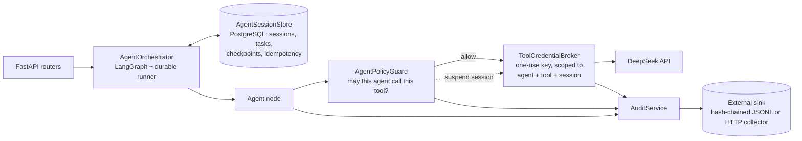

# AstroIntel agent architecture: five boundaries

AstroIntel's agent backend splits into five parts. Each part owns one question.

| Component | Question it answers | Where it lives | Status |
|---|---|---|---|
| **AgentOrchestrator** | What runs next, and where do we resume after a crash? | `graph/pipeline.py` (LangGraph agent graph), `workflow/runner.py` (durable runner: leases, retries, approval interrupt) | Existed |
| **AgentSessionStore** | What does this session know, and does it survive a restart? | `session_store.py` (session state), `workflow/store.py` (task state, idempotency), `workflow/checkpointer.py` (LangGraph checkpoints), all through `database.py` (PostgreSQL in the cloud, SQLite locally) | Existed |
| **ToolCredentialBroker** | Which secret may this agent use for this tool, right now? | `credentials/broker.py` | **New** |
| **ExecutionSandbox** | Where does untrusted code run? | Not built: no agent runs code (see below) | **Not needed yet** |
| **AuditService** | What happened, written somewhere the app can't rewrite? | `audit/audit_service.py` (external sink), fed by `audit/agent_audit_log.py` and `policy/guard.py` | **New** (the in-app logs existed) |



## Is it necessary? The verdict, part by part

**AgentOrchestrator and AgentSessionStore: you already had both.** The LangGraph graph decides the order of the steps. The durable runner adds checkpoints, leases, retries and the human-approval pause. State lives in PostgreSQL through `database.py`. Wrapping these in new classes called `AgentOrchestrator` and `AgentSessionStore` would only rename files that already have one job each. This document maps the names to the code instead.

**ToolCredentialBroker: yes, this was a real gap.** Before this change:
- `utils/deepseek_client.py` read `DEEPSEEK_API_KEY` from the environment once and kept it in a module global for the life of the process.
- `routers/analysis.py` read the same key again for the translate endpoint.
- The translate endpoint called DeepSeek without going through the policy guard at all.
- When the guard suspended a session, the session could still reach the key.

**AuditService: yes, but only the "external" part.** Two audit tables already existed: `agent_audit_log` and the hash-chained `policy_decision_log`. Both sit in the application's own database, so whoever holds the app's database credentials can also rewrite them. The new service copies every record to a sink outside that database.

**ExecutionSandbox: no, not for AstroIntel today.** A sandbox isolates code that you don't trust. Here, every agent tool is either `llm.chat` (an HTTPS call with checked arguments) or `report.generate` (the app's own code). No agent runs model-written code, shell commands or user scripts. A sandbox now would be an empty box drawn on a diagram. You'd add one the day any of these appears:
- a code-interpreter tool (the model writes Python and runs it);
- a tool that runs customer-supplied scripts or templates;
- parsing of untrusted file formats with native libraries, such as uploaded PDFs or other documents. The palm images go through Pillow today. That is a small risk, and the fix would be a separate worker rather than a full sandbox.

The design for it is short: a gVisor or Firecracker sandbox, or a separate Cloud Run job, with no network except an allow-list, a read-only root filesystem, CPU, memory and time limits, and no credentials inside. The broker never issues a credential into the sandbox.

## ToolCredentialBroker

```python
enforce(agent_id, "llm.chat", args)                         # 1. the guard decides
cred = broker.issue(agent_id, "llm.chat", session_id=sid)   # 2. a handle, not a secret
with broker.use(cred, "llm.chat") as key:                   # 3. the secret exists only here
    request = build_request(key)
```

| Property | Rule |
|---|---|
| Scope | One agent, one tool, one session. A handle for `llm.chat` can't unlock another tool. |
| Lifetime | 60-second TTL, **one use** by default. A handle can't be replayed. |
| Revocation | When the guard suspends a session (3 denials, or a high-risk attempt), every credential of that session is revoked and no new ones are issued. |
| Forgery | The broker compares the whole handle, not just its id. Changing the agent, or extending the expiry, is refused. |
| Source | `EnvSecretSource` (environment, then `.env`). Swap it for GCP Secret Manager in one class, without touching any agent. |
| Missing key | Raises `SecretNotConfigured`, a `RuntimeError`, so the agents' existing fallbacks still work. |
| Audit | Every issue, use, refusal and revocation goes to the AuditService. The secret itself never does. |

**What it is not:** the broker runs in the same process as the agents. It is a boundary in the code, not a wall against code that is already running in that process. The next step for real isolation is to run it as its own service (or behind an egress proxy) that adds the `Authorization` header on the way out, so the agent process never holds the key at all.

## AuditService

`emit()` writes one record per action: agent node runs, permission checks, guard decisions, and credential events. Each record carries who (user, tenant), where (session, correlation id), what (agent, tool, action, status) and detail.

| `AUDIT_SINK` | Behaviour |
|---|---|
| `jsonl` (default) | Appends to `AUDIT_EXTERNAL_PATH`. Each line carries `prev_hash` and `record_hash`, and is written with fsync. `verify_jsonl(path)` finds an edited or deleted line. Each write takes an exclusive file lock and reads the previous hash from the file itself, so several uvicorn workers can share one file without forking the chain. A test checks this with 4 processes writing at once; without the lock, the chain breaks at record 22. |
| `http` | POSTs each record to `AUDIT_SINK_URL` from a background thread. If the queue fills, the record is dropped and counted (`audit_external_dropped`). |
| `none` | Off. |

`emit()` never raises: an audit failure must not fail the user's request. Failures are counted in `audit_external_failures`, so a broken sink shows up as a number in the metrics instead of quietly losing records.

**Production:** point the JSONL file at storage the app can only append to, such as a GCS bucket with a retention lock. Or use the HTTP sink to send records to a collector in a different project. A file on the app's own disk shows the format and the chain, but it is not "external" on its own.

## Configuration

| Variable | Default | Meaning |
|---|---|---|
| `DEEPSEEK_API_KEY` | (none) | Read only by the broker |
| `AUDIT_SINK` | `jsonl` | `jsonl`, `http` or `none` |
| `AUDIT_EXTERNAL_PATH` | `audit_records/execution_records.jsonl` | JSONL sink file (gitignored) |
| `AUDIT_SINK_URL` | (none) | Collector URL for the `http` sink |

Tests: `pytest tests/test_credential_broker_and_audit.py -v`

## Saying it in an FDE interview

**The 60-second version:**
> "I split the agent platform into five boundaries, each owning one question. The orchestrator, which is LangGraph plus a durable runner with checkpoints and leases, decides what runs next and where to resume. The session store, in PostgreSQL, holds state that survives restarts. A policy guard decides whether an agent may call a tool. A credential broker then issues a one-use credential scoped to that agent, that tool and that session, so agents never hold a long-lived key, and suspending a session revokes its credentials immediately. An audit service writes every agent action, decision and credential use to a hash-chained sink outside the app's database. I deliberately didn't build a sandbox: none of our agents run code. I can say exactly what would trigger one: a code-interpreter tool or customer scripts."

**Follow-up: why not just read the key from the environment? It's simpler.**
Then every line of code in the process can use it, for anything, forever. With the broker, there's one place that reads secrets, every use is tied to an agent and a session in the audit record, a misbehaving session loses access at once, and moving to Secret Manager is a one-class change. It cost about 200 lines.

**Follow-up: the broker is in-process. Isn't that security theatre?**
It's an honest code boundary, not isolation, and I'd say so. It still gives you scoping, revocation and an audit trail. Real isolation means moving the broker out: a separate service or egress proxy that injects the header, with the agent workload's identity (Workload Identity) deciding what it may ask for.

**Follow-up: why audit outside the database you already have?**
Because the application holds credentials to its own database. If the app is compromised, the attacker can edit the rows that would show what happened. A hash chain detects edits only if you keep the latest hash somewhere else. So the copy goes to append-only storage that the app can write to but can't delete from.

**Follow-up: what if the audit sink is down?**
The request still succeeds, the failure is counted and alerted on, and the in-database logs still hold the record. The trade-off is "fail open on audit". For the policy guard itself I chose the opposite: if a guard decision can't be recorded, the tool call is refused.

**Follow-up: when would you add the ExecutionSandbox?**
The day an agent runs code it didn't ship with: a code interpreter, customer scripts, or native parsing of untrusted files. It would be gVisor or a separate job with no credentials, an allow-listed network, a read-only filesystem and resource limits.
