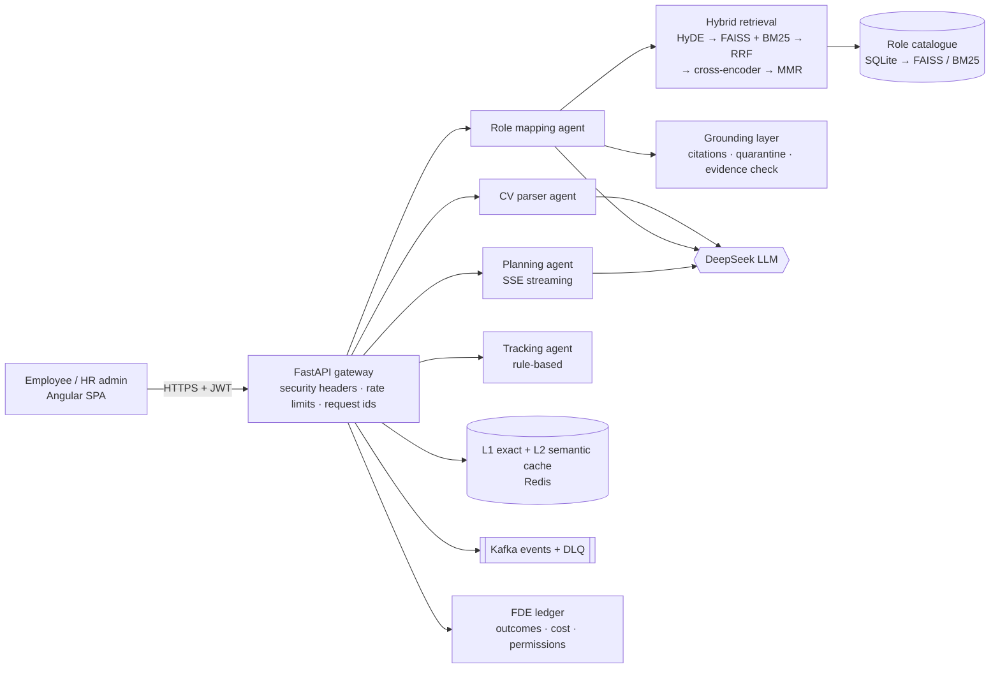

# Bench Resource Optimizer — Case Study

**What it is:** an AI system that reads a bench employee's CV, scores them against an
open project role, lists the exact skills they are missing, and builds a day-by-day
plan to close the gap — with every answer traced back to the role document it came from.

**Status:** working end to end on real AI (DeepSeek), covered by unit, evaluation and
browser tests. Not yet deployed for a customer, so the business numbers below are split
clearly into **measured** (from this codebase) and **modelled** (from stated assumptions).

| | |
|---|---|
| Built by | Chandan Kumar, solo — scoping, build, testing, documentation |
| Stack | FastAPI · LangChain · DeepSeek · FAISS + BM25 hybrid RAG · Angular · SQLite · Redis · Kafka · Docker |
| Code | `bench-resource-optimizer/` in [RavSinghChandan/ai-engineer](https://github.com/RavSinghChandan/ai-engineer) |

---

## 1. The customer problem

An IT services company always has people "on the bench": billable engineers between
projects. Every bench day is salary with no revenue, and a resource manager has to
answer four questions for each person before they can be staffed again:

1. What can this person actually do? (Their CV is a PDF in a shared folder.)
2. Which open role are they closest to?
3. Exactly what are they missing for that role?
4. What should they study this week, and how far along are they?

Today that is manual: read the CV, compare it with the role description, write a
training plan, chase progress. It is slow, inconsistent between managers, and the
skill gaps are often guessed — a guessed gap ("needs Kubernetes" when the role never
asked for it) sends someone into a week of training they did not need.

**Who uses it:** the bench employee (uploads a CV, picks a role, follows the plan) and
the HR / resource manager (maintains the role catalogue, sees readiness across the bench).

**What "good" looks like for the customer:** people become deployable sooner, every
skill gap can be justified from the role's own requirements, and no employee data leaks
or gets changed by the AI without a human.

---

## 2. System architecture

**Request flow for one employee**

| Step | Component | What happens |
|---|---|---|
| 1. Upload CV | CV parser agent | PDF text extracted locally, screened for prompt injection, trimmed to 1,200 characters, parsed by the LLM into a JSON profile (skills, years, roles). |
| 2. Pick a role | Role mapping agent | HyDE writes a hypothetical role description; hybrid search (FAISS dense + BM25 keyword, fused with RRF, re-ranked by a cross-encoder, diversified with MMR) returns the top role documents. |
| 3. Ground the answer | Grounding layer | Documents are numbered S1, S2…; any document containing instructions for the model is quarantined; the LLM must cite the documents it used; every missing skill must appear in a cited document and every matched skill must also be on the CV — otherwise it is removed. |
| 4. Plan | Planning agent | Missing skills become a day-by-day plan, streamed to the browser, with internal training resources. |
| 5. Track | Tracking agent | Completed tasks become a readiness score — no model call. |

**Design choices worth defending**

- **Hybrid retrieval, not dense-only.** Role titles and skill names are exact tokens
  ("Spring Boot", "Airflow"); BM25 catches them when embeddings blur them.
- **Embeddings run locally** (`all-MiniLM-L6-v2`): no embedding API cost, and role
  documents never leave the server for indexing.
- **Deterministic evidence check.** The check that removes unsupported skills is plain
  code (term match against the cited document), not a second LLM — it cannot be talked
  into passing a confident but wrong answer.
- **Default-deny agent permissions.** Each agent has a declared read / write list
  (`fde/config.py`); staffing decisions are flagged for human approval, never taken.
- **Prompts are versioned** (`prompts/v1..v3`) and the evaluation suite tests the exact
  production prompt, so a prompt change is measured before it ships.

---

## 3. Deployment plan

Already in the repo: multi-stage Docker image running as a non-root user,
`docker-compose.yml` (backend, Redis, Kafka, Zookeeper), GitHub Actions CI
(`.github/workflows/bench-ci.yml`: pytest + Angular build on every push touching the project),
and Playwright browser tests that start a throwaway backend copy.

| Phase | Scope | Exit criteria |
|---|---|---|
| **0. Discovery (week 1)** | Sit with 2–3 resource managers; time the manual flow; collect the real role catalogue and 20 anonymised CVs. | Measured baseline minutes replace the assumptions in §6; role catalogue loaded. |
| **1. Pilot (weeks 2–5)** | One business unit, ~50 bench employees. Hosted in the customer's cloud tenant (container on ECS / Azure Container Apps), SSO in front, DeepSeek or a customer-approved model behind a data-processing agreement. Managers review every role fit before acting. | Success criteria in §6 met; no P1 security findings; managers' acceptance rate of AI skill gaps ≥ 85%. |
| **2. Production (weeks 6–8)** | Move SQLite → PostgreSQL, enable Redis + Kafka, secrets in the cloud secret manager, alerting on the FDE ledger (success rate, cost per successful task, latency P95). | 99.5% availability over 2 weeks; on-call runbook signed off. |
| **3. Scale** | All business units; role catalogue synced from the HR system; nightly evaluation run. | Cost per successful task and evaluation pass rate stable release over release. |

**Release gates (every change):** unit tests + coverage, the evaluation suites in
`evals/` on both models, the Playwright suite, and a canary on the pilot unit before
everyone gets it. Rollback = redeploy the previous image; prompt changes roll back by
switching `ACTIVE_VERSIONS` in `utils/prompts.py`.

---

## 4. Security controls

| Risk | Control in the code |
|---|---|
| Unauthorised access | JWT (HS256, 24 h expiry, secret from env), role-based access: admin routes (role catalogue, document upload) require the admin role. |
| Abuse / cost blow-up | IP rate limit (60 requests / min), per-user limit on AI calls (20 / min), circuit breakers (open after 5 failures) with retry and back-off. |
| Prompt injection in a CV | Injection screen on CV text and role names before any model call; CV text capped at 1,200 characters. |
| **Poisoned role document (RAG injection)** | Retrieved documents are scanned before reaching the model; a document that gives orders ("ignore your instructions", "call the grant_admin tool", "reveal the password") is quarantined and shown to the admin. Zero false positives on the real catalogue. |
| Model calls an unauthorised tool | The model's output is parsed against a fixed list of fields — any extra field (e.g. `"tool_call"`) is dropped; agents run under a default-deny permission matrix; tool-call requests in an answer are flagged and the recommendation replaced. |
| Restricted data in an answer | Output guard blocks secrets, e-mail addresses, phone numbers and planted canary values; PII scrub on role-mapping output. |
| Hallucinated skill gaps | Evidence check removes any skill not present in a cited role document (or, for matched skills, not on the CV) and lists what it removed. |
| Data at rest / transit | HSTS and security headers; only the parsed profile plus the first 500 characters of CV text are stored; the uploaded PDF bytes are discarded. |
| Supply chain / runtime | Non-root multi-stage container on a slim base image, SonarQube quality gate, tests in CI on every push. |

**Known gaps before a real customer** (stated, not hidden):

- The trimmed CV text is sent to the external LLM for parsing. For production: redact
  contact details before the call, or use a customer-hosted model.
- An unreadable PDF returns HTTP 500 and an AI outage returns 500 instead of a friendly 503.
- JWT secret rotation and SSO are designed for (phase 1) but not built.

---

## 5. Evaluation metrics

Three layers, each reproducible from the repo.

**a) Offline evaluation suites (`evals/`, run with `python -m fde.evals`)** — the exact
production prompt, temperature 0, reports committed with prompts, outputs, tokens and cost.

| Suite | What it checks | deepseek-chat | deepseek-reasoner |
|---|---|---|---|
| `cv_parser.json` (6 cases) | Skills, years and roles extracted; injected instructions in a CV refused; no invented contact details | 6/6 · P50 1.09 s · $0.000060 per passed case | 6/6 · P50 1.86 s · $0.000771 per passed case |
| `rag_grounding.json` (5 cases) | Answers cite their documents and list only skills the documents state; a poisoned document cannot leak a restricted HR record or the system prompt, emit a tool call, or force the score | 5/5 · P50 1.12 s · $0.000079 per passed case | 5/5 · P50 1.99 s · $0.000843 per passed case |

Result: `deepseek-chat` matches the reasoning model on quality at roughly **10–13× lower
cost per passed case**, so it is the production default.

**b) Live product metrics (FDE ledger, `GET /fde/outcomes`)** — recorded per task:
success / failure / degraded rate, inputs rejected, latency P50 / P95, cache hit rate,
cost per task and **cost per successful task**, retries, human review coverage and
intervention rate, permission denials, approvals requested, and time saved against the
manual baseline.

**c) Grounding metrics (returned with every role fit)** — `evidence.checked`,
`evidence.supported`, the skills removed and why, and the documents quarantined. The UI
shows them as "Evidence: 10/10 skills supported".

**Test coverage:** 572 backend tests passing (one pre-existing failure in an IP-header
test unrelated to the AI path; one known-hanging logging test skipped), 20 Playwright browser tests offline and 2 live tests
against the real model, including an end-to-end attack in which an admin adds a poisoned
role and a user maps to it.

---

## 6. Measurable business outcome

### Measured in this codebase

| Measure | Result | Source |
|---|---|---|
| End-to-end time, CV → role fit → 7-day plan | ~22 s in an automated browser run | Playwright live test |
| Model cost for that full flow | $0.000264 (average 1,371 tokens per model request) | `/metrics` token economics, live run |
| Skill gaps traceable to a role document | 10/10 on a real CV in the live run; unsupported gaps removed automatically | evidence block, live run |
| Poisoned document | Quarantined before the model saw it; score stayed 0 instead of the forced 100; no leak, no tool call | Playwright live attack test |

### Modelled for a pilot (assumptions, to be replaced in discovery)

Manual baseline per employee, from `fde/config.py` (labelled as assumptions until
measured with the customer): CV review 15 min + role comparison 30 min + training plan
60 min = **105 minutes**. Assumed manager review of the AI output: 10 minutes.

| For a bench of 50 people | Manual | With the system |
|---|---|---|
| Manager time | 87.5 h | 8.3 h review + ~20 min compute |
| Model cost | — | ≈ $0.01 |
| **Time saved** | | **≈ 79 manager hours per bench cycle (≈ 90%)** |

The larger lever is **days on the bench**. Each day an employee becomes deployable
sooner saves one day of unbilled salary:

> savings per cycle = bench headcount × days saved per person × daily cost per person

The pilot measures *days saved* rather than assuming it.

### Pilot success criteria (what the customer signs off)

1. Median time from "on bench" to "deployment ready" drops by **≥ 20%** against the
   previous quarter for the same unit.
2. Managers accept **≥ 85%** of AI-identified skill gaps without edits (review coverage
   and intervention rate in the FDE ledger).
3. **100%** of skill gaps in delivered plans trace to a cited role document
   (`evidence.unsupported` empty after the check).
4. Cost per successful task stays **under $0.01**; task success rate **≥ 95%**.
5. Zero restricted-data leaks or unauthorised actions in the pilot (output guard and
   permission-denial counters).

---

*Numbers above come from the reports in `backend/evals/reports/`, the FDE ledger and the
Playwright runs of 29 October 2026. Re-run them with the commands in each section.*
