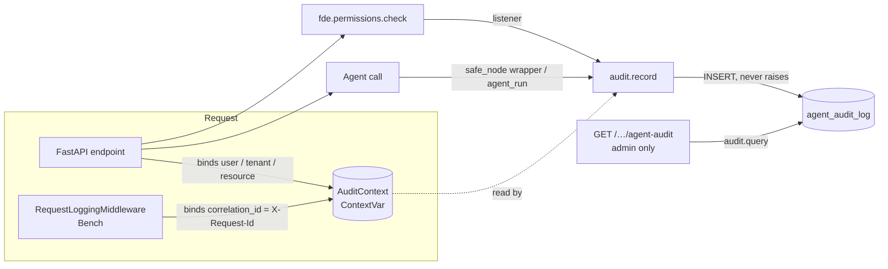
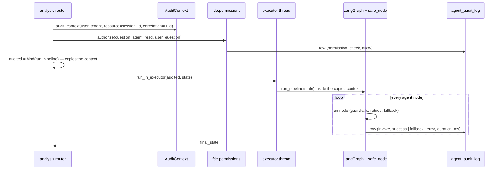
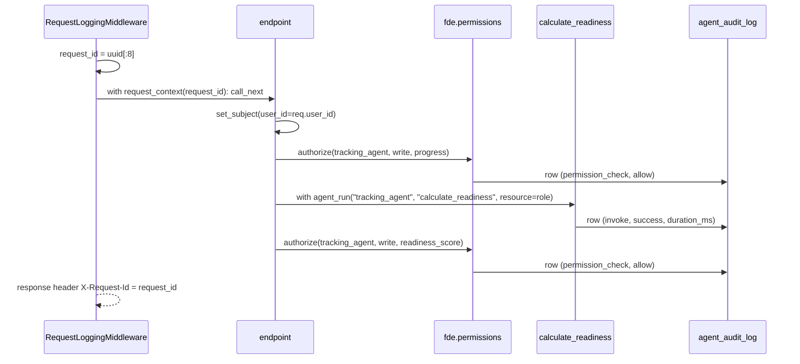

# LLD: Agent Audit Log

Low-level design of `agent_audit_log`, the durable record of every action an AI agent takes in **AstroIntel** and **Bench Resource Optimizer**. Both backends are Python (FastAPI).

| | |
|---|---|
| Status | Implemented — commit `b6fcbc8` |
| Code | [`astro-intel-backend/audit/agent_audit_log.py`](../../astro-intel-backend/audit/agent_audit_log.py) · [`bench-resource-optimizer/backend/audit/agent_audit_log.py`](../../bench-resource-optimizer/backend/audit/agent_audit_log.py) |
| Tests | [`astro-intel-backend/tests/test_agent_audit_log.py`](../../astro-intel-backend/tests/test_agent_audit_log.py) (19) · [`bench-resource-optimizer/backend/tests/test_agent_audit_log.py`](../../bench-resource-optimizer/backend/tests/test_agent_audit_log.py) (13) |

---

## 1. Problem

Before this change, both apps wrote agent activity only as log lines (`RBAC | GRANTED | ...`, `{"event":"llm_audit",...}`). Logs answer "what happened around 14:02?" but not:

- *Which agents acted for user X last week, and on what?*
- *Everything that happened in request `abc123`, in order.*
- *Which agent was denied access to which data resource?*

These need a **queryable, structured, durable** record keyed by agent, user, resource and request.

## 2. Requirements

**Functional**
1. One row per agent action: an agent run, or an agent permission decision.
2. Each row says *which agent*, *for which user*, *which tool*, *on which resource*, *what action*, *outcome*, *when*, and *which request* it belonged to.
3. All rows of one API request share a `correlation_id`.
4. Admins can read rows, filtered by correlation id, agent, user/resource or status.
5. Multi-tenant isolation in AstroIntel: an admin only ever sees their own tenant.

**Non-functional**
- **Never break the request.** An audit write that fails is logged and dropped.
- **No agent code changes.** Capture happens at existing choke points.
- **Cheap.** One short insert per action; indexed reads.
- **Dialect-neutral** where the app already is (AstroIntel runs on SQLite or PostgreSQL).

## 3. Data model

```sql
CREATE TABLE agent_audit_log (
    id              INTEGER PRIMARY KEY AUTOINCREMENT,   -- BIGSERIAL on PostgreSQL
    agent_id        TEXT NOT NULL,              -- "question_agent", "role_mapping_agent", ...
    user_id         TEXT NOT NULL DEFAULT '',   -- who the request was for
    tenant_id       TEXT NOT NULL DEFAULT '',   -- AstroIntel only
    tool_name       TEXT NOT NULL DEFAULT '',   -- function the agent ran, or "permission_check"
    resource_id     TEXT NOT NULL DEFAULT '',   -- session / role / data resource acted on
    action          TEXT NOT NULL,              -- "invoke" | "read" | "write" | "request_approval"
    status          TEXT NOT NULL,              -- "success" | "fallback" | "error" | "allow" | "deny" | "human_required"
    correlation_id  TEXT NOT NULL DEFAULT '',   -- one value per API request
    timestamp       REAL NOT NULL,              -- epoch seconds
    duration_ms     REAL NOT NULL DEFAULT 0     -- 0 for untimed rows (permission checks)
);

CREATE INDEX idx_agent_audit_tenant_ts   ON agent_audit_log(tenant_id, timestamp);  -- AstroIntel
CREATE INDEX idx_agent_audit_ts          ON agent_audit_log(timestamp);             -- Bench
CREATE INDEX idx_agent_audit_correlation ON agent_audit_log(correlation_id);
CREATE INDEX idx_agent_audit_agent       ON agent_audit_log(agent_id);              -- AstroIntel
CREATE INDEX idx_agent_audit_user        ON agent_audit_log(user_id);               -- Bench
```

**Design choices**
- **Append-only.** No update or delete paths in application code.
- **`NOT NULL DEFAULT ''`** instead of NULLs: filters stay simple (`= ?`), and "unknown" is explicit.
- **Epoch `REAL` timestamps** match every other table in both apps.
- **`tenant_id` in AstroIntel only.** Bench has no tenants.
- **Indexes follow the read paths:** newest-first per tenant, one request by correlation id, per agent / per user.

### Value conventions

| Row kind | `action` | `status` | `tool_name` | `resource_id` |
|---|---|---|---|---|
| Agent run | `invoke` | `success` / `fallback` / `error` | agent function, e.g. `meta_agent_node`, `map_role` | AstroIntel: session id · Bench: target role |
| Permission decision | `read` / `write` | `allow` / `deny` | `permission_check` | data resource, e.g. `birth_profile`, `user_profile` |
| Human gate | `request_approval` | `human_required` | `permission_check` | gated resource |

## 4. Components



| Component | AstroIntel | Bench |
|---|---|---|
| Module | `audit/agent_audit_log.py` | `audit/agent_audit_log.py` |
| Table creation | `database.init_db()` → `init_table()` | `db.init_db()` runs `DDL` |
| Agent-run capture | `guardrails.core.safe_node` (wraps every graph node) | `agent_run(...)` context manager around each agent call in `main.py` |
| Permission capture | `fde.permissions.add_listener(record_permission)` | same |
| Correlation id | new UUID per pipeline request | `request.state.request_id` (returned as `X-Request-Id`) |
| Read API | `GET /api/v1/metrics/agent-audit` | `GET /admin/agent-audit` |
| Writer | `database._tx()` (SQLite or psycopg2) | stdlib `sqlite3` (works from sync code and threads) |

### 4.1 Public API of the module

```python
audit_context(correlation_id=..., user_id=..., tenant_id=..., resource_id=...)  # AstroIntel, context manager
request_context(correlation_id)                                                 # Bench, used by middleware
set_subject(user_id=..., resource_id=...)                                       # Bench, used by endpoints
bind(fn) -> fn                                                                  # AstroIntel: carry context into a thread
record(agent_id, action, status, *, tool_name, resource_id, duration_ms, ...)   # one row, never raises
agent_run(agent_id, tool_name, *, resource_id)                                  # Bench: times a call, success/error
record_permission(agent, action, resource, decision)                            # fde.permissions listener
query(*, tenant_id / user_id, correlation_id, agent_id, status, limit)          # newest first, limit ≤ 1000
```

Any field not passed to `record()` is taken from the current `AuditContext`. Explicit arguments win, which is how a permission row stores `birth_profile` as its resource while an agent-run row stores the session.

## 5. Request flows

### 5.1 AstroIntel — `POST /api/v1/analysis/run`



**Why `bind()`:** `loop.run_in_executor` does **not** copy context variables into the worker thread. Without it, every node row would lose user, tenant and correlation id. `bind()` captures `contextvars.copy_context()` on the request task and runs the pipeline inside it. LangGraph then propagates the context to its own nodes. A test runs a real two-node LangGraph graph through `run_in_executor` to prove this.

**Why the context closes before the `try`:** the permission checks stay *outside* the existing `try/except`, exactly where they were. Otherwise a `PermissionDenied` would be recorded in the FDE ledger as a failed task, which would change behaviour. `bind()` captures the context when called, so the block can close before the pipeline runs.

**Fallback detection:** `safe_node`'s existing logic is untouched (renamed `_guarded`). A thin wrapper compares the length of `guardrail_warnings` before and after, because `_fallback_state` appends exactly one. A warning carried in from an earlier node is therefore not miscounted.

### 5.2 Bench — `POST /update-progress`



The correlation id is the value already returned in `X-Request-Id`. A support engineer can take it from any response and pull every agent action for that request from `/admin/agent-audit?correlation_id=…`.

In `/upload-cv`, the user id only exists after parsing, so `set_subject(user_id=…)` is called as soon as it's assigned. Earlier rows in that request (CV parse) have an empty `user_id` but the same correlation id.

## 6. Read API

| | AstroIntel | Bench |
|---|---|---|
| Route | `GET /api/v1/metrics/agent-audit` | `GET /admin/agent-audit` |
| Auth | `Permission.METRICS__VIEW` (ADMIN, SUPERADMIN) | `require_admin` (JWT role `admin`) |
| Filters | `correlation_id`, `agent_id`, `resource_id`, `status`, `tenant_id`*, `limit` | `correlation_id`, `agent_id`, `user_id`, `status`, `limit` |
| Response | `{"count": n, "rows": [...]}` newest first | same |

\* **Tenant isolation:** an ADMIN's query is always forced to `ctx.tenant_id`, and any `tenant_id` parameter is ignored. Only a SUPERADMIN can pass `tenant_id`, or omit it to read every tenant. In `query()`, `tenant_id=None` means all tenants, but `tenant_id=""` is a real (empty) tenant, never "all", so an unauthenticated context can't widen the scope by accident.

`limit` is clamped to 1–1000. All values are bound parameters, never interpolated into SQL. Only fixed column names are.

## 7. Failure handling

| Failure | Behaviour |
|---|---|
| Database unreachable / locked during a write | `record()` logs a warning and returns. The request continues. |
| Agent raises | AstroIntel: `error` row, then the exception propagates unchanged. Bench: `agent_run` writes an `error` row and re-raises. |
| Agent falls back (AstroIntel relaxed mode) | `fallback` row. The pipeline continues as before. |
| Request has no context (background job, tests) | Rows are still written, with empty user / correlation fields. |
| Listener registered twice | `add_listener` is idempotent. One row per decision. |

## 8. Performance

- **Rows per request:** AstroIntel `/run` writes ~6 permission rows plus one row per graph node (~8). Bench endpoints write 2–4.
- **Cost per row:** one short SQLite insert in WAL mode (sub-millisecond locally). On PostgreSQL it's one statement per row.
- **Bench writes synchronously** with `sqlite3` from the async handler. That is a deliberate trade-off: the permission listener is synchronous, and a sub-ms insert doesn't justify a queue. Under high load, the next step is a background writer (§10).
- **Reads** hit `(tenant_id, timestamp)` or `correlation_id` indexes.

## 9. Testing

| Area | What is asserted |
|---|---|
| Schema | Table has all required columns. `init` is idempotent. Bench's `init_db()` creates it. |
| Context | Fields filled from context. Explicit args override. Context resets after the block. |
| Robustness | `record()` doesn't raise when the database is down. |
| Agent runs | success / fallback / error rows from `safe_node`. A carried-over warning is not a fallback. `agent_run` around awaited calls. |
| Permissions | allow and deny rows with `permission_check`. The listener registers once. |
| Threading | Context survives `run_in_executor` **and** a real LangGraph graph. |
| API | Bench: a real `/update-progress` request writes 3 rows sharing the response's `X-Request-Id`. AstroIntel: USER gets 403, an ADMIN can't read another tenant, a SUPERADMIN can. |

Both suites fail if the hooks are removed (verified by reverting `safe_node`, `fde.permissions`, Bench `main.py` and the middleware one at a time).

## 10. Future work

- **Retention:** a scheduled `DELETE … WHERE timestamp < now - N days`, or time partitioning on PostgreSQL.
- **Async writer:** queue rows and batch-insert, if write volume grows.
- **Export:** ship rows to a SIEM (Datadog, CloudWatch) next to the existing log lines.
- **Payload hashes:** store a hash of each agent's input/output for tamper evidence, without storing PII.
- **Request-level correlation in AstroIntel:** accept an incoming `X-Correlation-ID` header, so the id spans services.
